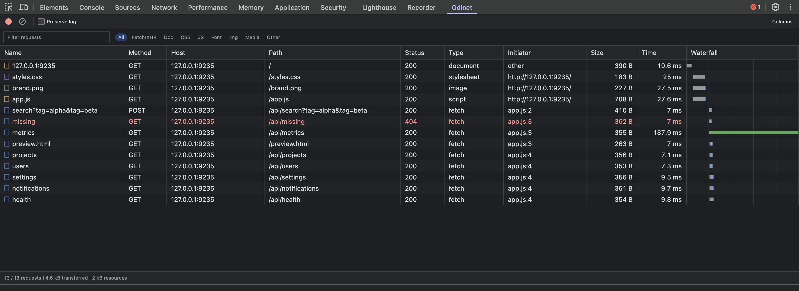

# Odinet

**Odinet** is an open source Chromium extension for inspecting HTTP and HTTPS requests while exploring websites. It combines a browser session popup with a DevTools panel modeled on Chromium's native Network workflow.

[Русская версия](README.ru.md)



Screenshots use a local test site. [Request details](docs/images/request-details.png) · [JSON viewer](docs/images/json-viewer.png).

## Current features

- Captures visible HTTP and HTTPS requests across browser tabs with Manifest V3 `chrome.webRequest`.
- Groups request lifecycle events by request ID, including redirects, completion and network errors.
- Shows method, URL, resource type, tab ID and final HTTP status in the popup.
- Keeps up to 200 recent records in session memory. No captured data is sent to a server.
- Localizes the manifest and popup into English and Russian using the browser UI language; English is the fallback.
- The DevTools panel provides a sortable request table with Name, Method, Host, Path, Status, Type, Initiator, Size, Time and Waterfall columns. Columns can be hidden and resized.
- Select a request to inspect Headers, Payload, Preview, Response, Initiator, Timing and Cookies. HTTP methods remain visible when details are open; response content is loaded on demand.
- JSON has a syntax highlighted tree and formatted text view, search across keys and values, paged arrays, and copy actions for the document, selected value and JSONPath. Hover or select any tree row to copy its complete value, including collapsed objects and arrays. Formatting and copying preserve original numeric literals and duplicate keys.
- Text and resource type filters, pause/resume recording, Preserve log, keyboard selection and resizable details support the native Network workflow.
- Enable **Element requests** in Odinet and click elements on the page without switching DevTools panels. Hover highlights the target; clicks select elements instead of activating links or buttons. Resource references and recorded Fetch/XHR data are matched automatically against text, attributes and formatted numbers, with JSONPath and conversion evidence. Data matches are labelled as possible relations.
- Clearing the DevTools panel removes its records and the inspected tab's background records. The popup still shows and clears the whole background session log.

## Requirements and setup

Install [Bun](https://bun.com/docs/installation) 1.4.0 or newer.

```sh
git clone https://github.com/mkrtc/odinet.git
cd odinet
bun ci
bun run check
bun test
bun run build
```

Open `chrome://extensions` in a Chromium browser, enable Developer mode and load the **`dist`** directory as an unpacked extension. On Helium, use its extensions page if the `chrome://` address is redirected. The popup then shows requests made after installation.

To use the DevTools panel, open a website, open DevTools and select **Odinet** (it may be under the `»` menu). After reloading the extension, close and reopen DevTools so the new panel can register.

To inspect a component, open **Odinet**, enable **Element requests**, and click the component on the page. Subsequent clicks select other elements while Odinet stays open. Press **Esc** or **Pause** to restore normal page interaction while keeping the results; **Pick** resumes selection. Picking pauses when another DevTools panel is opened and resumes when returning to Odinet, unless explicitly paused. Closing the mode or DevTools removes the picker. Native Elements selection remains available as a fallback.

Open a match to see its request details. **Related only** filters the main table; **Refresh** reads the chosen element again after it changes, and **Rescan** repeats analysis of the existing snapshot. See the [page picker](docs/images/element-picker.png) and [request evidence](docs/images/element-requests.png).

## Scope and privacy

The extension asks for `webRequest`, `storage`, `scripting`, and HTTP/HTTPS host access. The scripting permission is used to install the element picker on demand in the inspected tab's isolated extension context. Captured URLs may contain secrets in query parameters. The journal lives in `chrome.storage.session` and is cleared when the browser restarts or the extension is reloaded, disabled or updated. Use **Clear** in the popup to remove it sooner.

The popup collects metadata only, up to 200 records in session storage. The DevTools panel uses `chrome.devtools.network` and keeps up to 1,000 HAR records in panel memory. Those records may include headers, cookies and request bodies. Response bodies are read when Preview or Response is opened, and automatically on element selection while Element requests is enabled; at most four bodies are cached, each limited to 2 MiB. Element inspection reads a bounded DOM snapshot and retains it in panel memory until the selection changes, navigation, mode closure or DevTools closure. Data scans read existing recorded bodies and do not replay HTTP requests. Panel network data is removed on navigation unless Preserve log is enabled, and when DevTools closes. No traffic data is uploaded or exported.

Element associations are not a complete render trace. The current implementation matches image, CSS image, media and frame URLs, including descendants and open Shadow DOM. JSON matching compares exact strings (at least 8 characters) and recognizable formatted numbers using exact decimal arithmetic. Grouping, currency labels, rounding, fraction removal and percentage ratios are supported. A division by 100 requires an explicit `…Minor`, `…Cents` or `…Kopecks` field and a recognized currency with two decimal minor units. Plain numbers require at least three displayed digits; percentages require two. Shared styles/scripts, closed Shadow DOM, framework state, arbitrary calculations and unknown unit conversions are not inferred. Matching data can appear in unrelated responses; resource references cannot distinguish repeated loads of the same URL. DOM traversal and response scans are bounded and incomplete results are labelled. See [analysis budgets](docs/DESIGN.md#element-request-associations).

The picker supports the main document, open Shadow DOM and existing frames that the browser permits the extension to access (up to 128 frame connections). Browser-protected pages and inaccessible frames cannot be picked. Frames created after activation may require turning the mode off and on. A disconnected panel or worker releases the picker to restore page interaction.

The public DevTools API provides HAR snapshots and completed-request events, rather than the full internal CDP stream. Some requests made before DevTools opened may be unavailable; reload the page to capture them. Native throttling, full initiator dependency graphs, protocol streaming and header overrides are outside the current extension API integration. HTML previews show inert source code. Protected browser traffic remains unavailable.

See [the design and Chromium source research](docs/DESIGN.md) for the architecture and extension points.

## Project

- [Contributing](CONTRIBUTING.md)
- [Security policy](SECURITY.md)
- [MIT License](LICENSE) © 2026 Mkrtchian Sarkis
