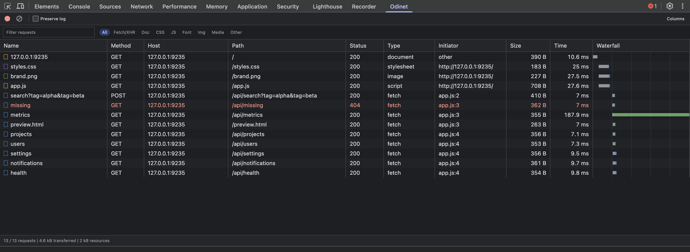

# Odinet

**Odinet** is an open source Chromium extension for inspecting HTTP and HTTPS requests while exploring websites. It combines a browser session popup with a DevTools panel modeled on Chromium's native Network workflow.

[Русская версия](README.ru.md)



Screenshots use a local test site. [Request details screenshot](docs/images/request-details.png).

## Current features

- Captures visible HTTP and HTTPS requests across browser tabs with Manifest V3 `chrome.webRequest`.
- Groups request lifecycle events by request ID, including redirects, completion and network errors.
- Shows method, URL, resource type, tab ID and final HTTP status in the popup.
- Keeps up to 200 recent records in session memory. No captured data is sent to a server.
- Localizes the manifest and popup into English and Russian using the browser UI language; English is the fallback.
- The DevTools panel provides a sortable request table with Name, Method, Host, Path, Status, Type, Initiator, Size, Time and Waterfall columns. Columns can be hidden and resized.
- Select a request to inspect Headers, Payload, Preview, Response, Initiator, Timing and Cookies. JSON previews are expandable; response content is loaded on demand.
- Text and resource type filters, pause/resume recording, Preserve log, keyboard selection and resizable details support the native Network workflow.
- Clearing the DevTools panel removes its records and the inspected tab's background records. The popup still shows and clears the whole background session log.

## Requirements and setup

Install [Bun](https://bun.com/docs/installation) 1.4.0 or newer.

```sh
git clone https://github.com/mkrtc/odinet.git
cd odinet
bun ci
bun run check
bun test
bun run build
```

Open `chrome://extensions` in a Chromium browser, enable Developer mode and load the **`dist`** directory as an unpacked extension. On Helium, use its extensions page if the `chrome://` address is redirected. The popup then shows requests made after installation.

To use the DevTools panel, open a website, open DevTools and select **Odinet** (it may be under the `»` menu). After reloading the extension, close and reopen DevTools so the new panel can register.

## Scope and privacy

The extension asks for `webRequest`, `storage`, and HTTP/HTTPS host access so it can observe traffic from all sites. Captured URLs may contain secrets in query parameters. The journal lives in `chrome.storage.session` and is cleared when the browser restarts or the extension is reloaded, disabled or updated. Use **Clear** in the popup to remove it sooner.

The popup collects metadata only, up to 200 records in session storage. The DevTools panel uses `chrome.devtools.network` and keeps up to 1,000 HAR records in panel memory. Those records may include headers, cookies and request bodies. Response bodies are fetched only when Preview or Response is opened; at most four previews are cached, each limited to 2 MiB. Panel data is removed on navigation unless Preserve log is enabled, and when DevTools closes. No traffic data is uploaded or exported.

The public DevTools API provides HAR snapshots and completed-request events, rather than the full internal CDP stream. Some requests made before DevTools opened may be unavailable; reload the page to capture them. Native throttling, full initiator dependency graphs, protocol streaming and header overrides are outside the current extension API integration. HTML previews show inert source code. Protected browser traffic remains unavailable.

See [the design and Chromium source research](docs/DESIGN.md) for the architecture and extension points.

## Project

- [Contributing](CONTRIBUTING.md)
- [Security policy](SECURITY.md)
- [MIT License](LICENSE) © 2026 Mkrtchian Sarkis
