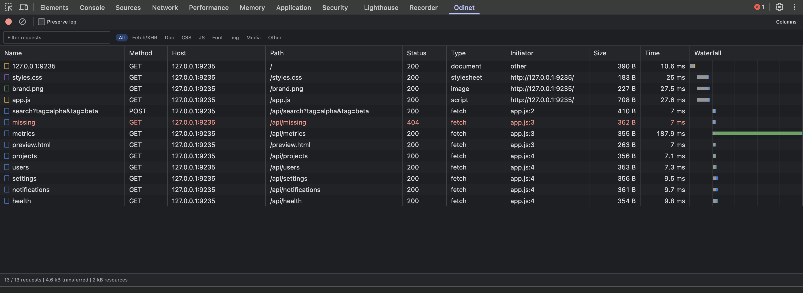

# Odinet

**Odinet** — расширение Chromium с открытым кодом для исследования HTTP- и HTTPS-запросов. Общий журнал сессии доступен в popup, а панель DevTools повторяет привычный сценарий работы с нативной вкладкой Network.

[English](README.md)



На скриншотах используется локальный тестовый сайт. [Подробности запроса](docs/images/request-details.png) · [Просмотр JSON](docs/images/json-viewer.png).

## Что работает

- Отслеживание доступных расширению HTTP- и HTTPS-запросов во всех вкладках через Manifest V3 `chrome.webRequest`.
- Объединение событий по ID запроса: начало, редиректы, успешное завершение и сетевые ошибки.
- Показ метода, URL, типа ресурса, ID вкладки и итогового HTTP-статуса.
- Локальный журнал последних 200 запросов без отправки данных на сервер.
- Английский и русский интерфейс по языку браузера; для остальных языков используется английский.
- В DevTools доступна таблица с колонками «Имя», «Метод», «Хост», «Путь», «Статус», «Тип», «Инициатор», «Размер», «Время» и диаграммой загрузки. Колонки можно сортировать, скрывать и менять их ширину.
- По клику открываются Headers, Payload, Preview, Response, Initiator, Timing и Cookies. HTTP-метод остаётся виден при открытых подробностях; тело ответа загружается по требованию.
- Для JSON есть дерево и форматированный текст с подсветкой, поиск по ключам и значениям, постраничное раскрытие массивов, копирование всего документа, значения и JSONPath. При наведении или выборе любой строки появляется кнопка копирования её полного значения, включая свёрнутые объекты и массивы. Большие числа и повторяющиеся ключи сохраняются при форматировании и копировании.
- Есть текстовый фильтр, фильтры типов ресурсов, пауза записи, сохранение журнала при навигации, управление с клавиатуры и изменение размеров области подробностей.
- Режим **«Запросы элемента»** находит ресурсы выбранного в Elements тега и его потомков, автоматически сопоставляет текст, атрибуты и форматированные числа с записанными Fetch/XHR-ответами. Показывает JSONPath и распознанные преобразования: округление, проценты, перевод минимальных денежных единиц. Совпадения данных помечены как возможные связи.
- Очистка в DevTools удаляет записи панели и фоновые записи исследуемой вкладки. Popup показывает и очищает общий фоновый журнал.

## Разработка и установка

Нужен [Bun](https://bun.com/docs/installation) версии 1.4.0 или новее.

```sh
git clone https://github.com/mkrtc/odinet.git
cd odinet
bun ci
bun run check
bun test
bun run build
```

Откройте `chrome://extensions` в браузере Chromium, включите режим разработчика и загрузите папку **`dist`** как распакованное расширение. В Helium используйте его страницу расширений, если адрес `chrome://` перенаправляется. После установки popup покажет новые запросы.

Для работы из DevTools откройте сайт, запустите инструменты разработчика и выберите **Odinet** (вкладка может находиться в меню `»`). После обновления расширения закройте и снова откройте DevTools, чтобы зарегистрировалась новая вкладка.

Для исследования компонента выберите его тег штатным инструментом DevTools или в **Elements**, вернитесь в Odinet и включите **«Запросы элемента»**. Пока режим включён, список следует за выбором тега и автоматически проверяет записанные JSON-ответы. По клику на совпадение откроются подробности запроса. **«Только связанные запросы»** фильтрует основную таблицу, **«Взять выбранный элемент»** обновляет снимок после изменения компонента, а **«Проверить ответы снова»** повторяет анализ существующего снимка. [Пример интерфейса](docs/images/element-requests.png).

## Границы и конфиденциальность

Разрешения `webRequest`, `storage` и доступ к HTTP/HTTPS сайтам нужны для наблюдения за всеми доступными вкладками. URL может содержать секреты в параметрах. Журнал хранится в `chrome.storage.session` и очищается после перезапуска браузера, перезагрузки, отключения или обновления расширения. Кнопка «Очистить» удаляет его раньше.

Popup собирает только метаданные, до 200 записей в памяти сессии. Панель DevTools получает данные через `chrome.devtools.network` и хранит до 1000 записей HAR в памяти панели. Они могут содержать заголовки, cookies и тела запросов. Тело ответа читается при открытии Preview или Response, а также автоматически при выборе элемента во включённом режиме «Запросы элемента»; кеш ограничен четырьмя ответами до 2 МиБ каждый. Снимок DOM ограничен по размеру и хранится в памяти панели до смены выбора, навигации, выключения режима или закрытия DevTools. Поиск читает записанные ответы и не повторяет HTTP-запросы. При навигации сетевые данные панели удаляются, если не включено сохранение журнала; закрытие DevTools также удаляет их. Данные не экспортируются и не отправляются на сервер.

Связи с элементом не являются полной трассировкой отрисовки. Сейчас сопоставляются URL изображений, изображений CSS, медиа и фреймов в теге, его потомках и открытых Shadow DOM. Поиск в JSON сравнивает точные строки длиной от 8 символов и распознаваемые форматированные числа с точной десятичной арифметикой. Поддерживаются разделители разрядов, знаки валют, округление, отбрасывание дробной части и процентные доли. Для деления на 100 требуются поле `…Minor`, `…Cents` или `…Kopecks` и распознанная валюта с двумя десятичными минимальными единицами. Для обычного числа нужны минимум три отображаемые цифры, для процентов две. Общие зависимости от стилей и скриптов, закрытые Shadow DOM, состояние фреймворка, произвольные вычисления и неизвестные единицы не определяются. Такие данные могут встречаться в несвязанных ответах, а ссылка на ресурс не позволяет отличить повторные загрузки одного URL. Обход DOM и поиск в ответах ограничены; неполные результаты отмечаются. [Ограничения анализа](docs/DESIGN.md#element-request-associations).

Публичный API DevTools предоставляет снимки HAR и события завершённых запросов, а не полный внутренний поток CDP. Часть запросов до открытия DevTools может быть недоступна; перезагрузите страницу для их захвата. Ограничение скорости сети, полный граф зависимостей инициаторов, потоковые протоколы и подмена заголовков пока не реализованы. HTML в Preview показан как безопасный исходный код. Защищённые запросы браузера недоступны.

Архитектура и изученные исходники Chromium описаны в [документе о дизайне](docs/DESIGN.md).

## Проект

- [Правила вклада](CONTRIBUTING.md)
- [Сообщения об уязвимостях](SECURITY.md)
- [Лицензия MIT](LICENSE) © 2026 Mkrtchian Sarkis
