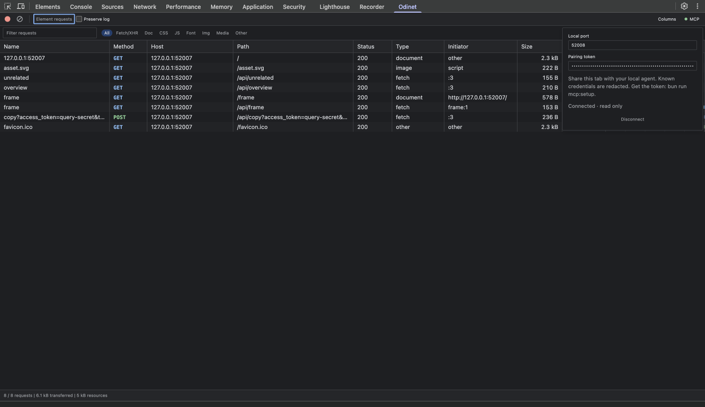

# MCP access to Odinet

[Русская версия](MCP.ru.md)

Odinet includes a local, read-only MCP server on Bun, using the official TypeScript MCP SDK. An MCP client starts it over **stdio**. A paired DevTools panel connects to its WebSocket bridge at `127.0.0.1:19865`. No remote service, CDP debugging port or browser source modification is needed.

## Connect

1. Run `bun ci && bun run build` in the repository. Load/reload `dist` as an unpacked extension and reopen DevTools.
2. Run `bun run mcp:setup`. This creates `~/.config/odinet/mcp.json` with an owner-only random pairing token and prints the bridge port, token and an MCP configuration with absolute paths. Setup does not start the server.
3. Copy the printed **`mcpServers` object** into your MCP client's server configuration. The generated entry uses your Bun executable and the absolute path to `scripts/mcp.ts`, so it works without setting a working directory. Restart/reconnect that MCP client; it starts Odinet's server automatically. Do not also run a second copy in a terminal.
4. Open the website's DevTools → **Odinet → MCP**, enter the printed port and token, and click **Connect**. A green dot and “Connected · read only” confirm the connection. Reload the website if the desired requests were made before DevTools opened.
5. Ask the agent to call `list_sessions`, select the desired tab, then call `list_requests`. Read an item with `get_request` or `get_response`.

The entry generated by setup looks like this (use the generated paths for your machine):

```json
{
  "mcpServers": {
    "odinet": {
      "command": "/absolute/path/to/bun",
      "args": ["/absolute/path/to/odinet/scripts/mcp.ts"]
    }
  }
}
```

The pairing token belongs in Odinet's MCP controls, not in the client's command arguments. Treat the setup output as a local secret; do not commit it. The panel keeps it in memory for reconnection and clears it on explicit disconnect or panel disposal. Pairing and sharing are off when a new panel opens. Closing DevTools or Disconnect removes the session. Merely switching DevTools panels leaves an explicitly connected session available.



## Tools

| Tool | Inputs | Result |
| --- | --- | --- |
| `list_sessions` | None | Connected session IDs, inspected tab IDs and connection times. Only explicitly paired panels appear. |
| `list_requests` | `sessionId`; optional `query`, `method`, `status`, `limit`, `after` | Bounded metadata and redacted URLs in capture order. Default 50, maximum 100 requests. `nextAfter` is the cursor for the next page or subsequent polling with the same filters. |
| `get_request` | `sessionId`, `requestId`; optional `offset`, `maxChars` | Redacted request and response, headers and available text bodies as Markdown. |
| `get_response` | Same as `get_request` | Redacted response status, headers and available text body as Markdown. |

Read tools return `text`, `offset`, `nextOffset`, `totalChars`, and `responseAvailable`. Default text page: 16,384 characters; maximum: 32,768. Follow `nextOffset` until it is `null`. Redaction happens **before** pagination. Original JSON numeric literals and duplicate keys are preserved. URLs in the metadata list are limited to 2,048 characters (`urlTruncated` identifies shortening); the full redacted URL is available in `get_request`.

Example tool arguments after discovering the session:

```json
{"sessionId":"<session UUID>","query":"/api/overview","method":"GET","limit":20}
```

```json
{"sessionId":"<session UUID>","requestId":"har-7","maxChars":16384,"offset":0}
```

These tools inspect the panel's existing, bounded HAR history (up to 1,000 entries). They do not replay traffic, evaluate page code, navigate, clear logs, enable capture or return raw credentials. Filters in the visible table do not restrict MCP reads: connecting shares the panel's recorded history. Each tab must be connected separately. The popup's background journal is not exposed.

## Lifecycle and limits

- The local bridge accepts only loopback Host, extension Origin and a matching 256-bit token. Authentication is carried in the WebSocket subprotocol, not a URL. HTTP access and website origins are rejected. MCP itself uses the client's local stdin/stdout pipes, not an HTTP endpoint.
- One server process owns a bridge port. Up to 16 panels may connect; reads are bounded to four per panel, with a 12-second bridge deadline and cancellation/disconnect cleanup. Wire frames are limited to 1 MiB.
- The server stores connection metadata and in-flight results in memory, with no traffic log on disk. The token configuration is the only persistent MCP file. Diagnostics use stderr; stdout is reserved for MCP.
- The extension reads response bodies on demand using the same four-body cache and 2 MiB source limit as the UI. Binary, unavailable and over-limit bodies are labelled and omitted rather than silently presented as complete.
- Clear/navigation/eviction can invalidate request IDs, pending reads and pagination cursors. Refresh the list after an expiry error. Navigation normally clears capture history; Preserve log follows the panel's existing rules.
- Panel reconnection retries use bounded exponential backoff, stopping after eight failed retries. Restarting the server gives sessions new IDs; call `list_sessions` again. Explicit Disconnect stops retries. A fresh DevTools panel requires explicit pairing again.

## Data handling

Request and response headers, URLs, JSON and forms use the same known-credential redaction policy as **Copy for agent**. Auth/cookie headers are removed; recognized tokens and secret fields are replaced. Multipart bodies and binary responses are omitted. This is not full anonymization: unknown credentials, business data and personal information can remain. Only connect tabs you intend to share with that MCP client. The client/agent may forward returned data to its own configured model provider; Odinet does not control its retention policy.

Captured content is marked as untrusted data. Website strings must never be treated as tool instructions. The server exposes no page execution or replay capability.

## Troubleshooting

- **No sessions:** the client's MCP server must be running, DevTools must be open, and that panel's MCP connection must be enabled. Run setup again to retrieve the existing token.
- **Connection failed/retrying:** check the port/token and your client's server startup logs. Another process may already own port 19865. `bun run mcp` is useful for manual startup diagnostics, but a normal MCP client owns this process.
- **More than one MCP client process:** use a separate configuration file, port and token for each instance. Set `ODINET_MCP_CONFIG=/absolute/path/config.json` when running setup; its generated client entry retains that environment variable. Edit the file's `port` before starting the client and use that port in the panel. To switch clients, disconnect the tab and connect it with the other token/port.
- **Rotate token:** stop the server, disconnect panels, remove its `mcp.json`, then run setup again. Re-pair desired panels with the new token. Existing pairing tokens are never added to the repository or extension build.

Protocol implementation: [official MCP TypeScript SDK](https://github.com/modelcontextprotocol/typescript-sdk), [stdio server transport](https://modelcontextprotocol.io/docs/develop/build-server), [Bun WebSocket server](https://bun.sh/docs/runtime/http/websockets).
