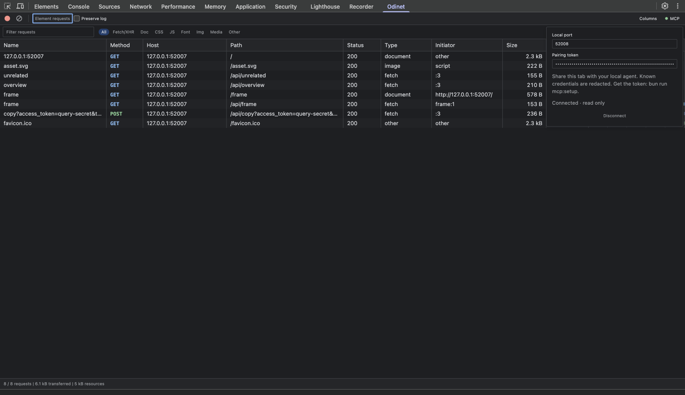

# MCP-доступ к Odinet

[English](MCP.md)

Локальный MCP-сервер на Bun позволяет агенту читать запросы из явно подключённых панелей Odinet. Используется официальный TypeScript SDK MCP. Клиент запускает сервер через **stdio**, панель подключается к его WebSocket-мосту на `127.0.0.1:19865`. Внешний сервис, порт отладки CDP и изменения браузера не требуются.

## Подключение

1. Выполните `bun ci && bun run build` в репозитории. Загрузите/обновите расширение из `dist` и переоткройте DevTools.
2. Выполните `bun run mcp:setup`. Команда создаст `~/.config/odinet/mcp.json` со случайным токеном и доступом только владельцу файла. В консоли появятся порт, токен и MCP-конфигурация с абсолютными путями. Сервер эта команда не запускает.
3. Перенесите напечатанный объект **`mcpServers`** в настройки вашего MCP-клиента. Там уже указаны Bun и `scripts/mcp.ts` с абсолютными путями. Перезапустите подключение в клиенте: сервер запустится автоматически. Второй экземпляр в терминале запускать не нужно.
4. На нужном сайте откройте DevTools → **Odinet → MCP**, введите порт и токен и нажмите **«Подключить»**. Зелёная точка и статус «Подключено · только чтение» подтверждают связь. Если запросы прошли до открытия DevTools, перезагрузите страницу.
5. Попросите агента вызвать `list_sessions`, выбрать вкладку, затем вызвать `list_requests`. Конкретный запрос читается через `get_request`, ответ — через `get_response`.

Пример структуры настроек (используйте пути, выданные setup на вашей машине):

```json
{
  "mcpServers": {
    "odinet": {
      "command": "/absolute/path/to/bun",
      "args": ["/absolute/path/to/odinet/scripts/mcp.ts"]
    }
  }
}
```

Токен вводится в панели Odinet, а не в аргументах MCP-клиента. Вывод setup содержит локальный секрет: не добавляйте его в репозиторий. Панель держит токен в памяти для переподключения и очищает его при явном отключении или закрытии. Новая панель всегда открывается с выключенным доступом. Переключение на другую вкладку DevTools сохраняет явно включённое подключение; «Отключить» или закрытие DevTools удаляет сессию.



## Инструменты

| Инструмент | Аргументы | Результат |
| --- | --- | --- |
| `list_sessions` | Нет | ID подключённых сессий, ID вкладок и время подключения. |
| `list_requests` | `sessionId`; необязательные `query`, `method`, `status`, `limit`, `after` | Метаданные и очищенные URL в порядке захвата. По умолчанию 50 записей, максимум 100. `nextAfter` передаётся как `after` для следующей страницы или опроса новых записей с теми же фильтрами. |
| `get_request` | `sessionId`, `requestId`; необязательные `offset`, `maxChars` | Запрос и ответ с очищенными заголовками, URL и доступными текстовыми телами, в Markdown. |
| `get_response` | Как у `get_request` | Статус, очищенные заголовки и доступное тело ответа в Markdown. |

Чтение возвращает `text`, `offset`, `nextOffset`, `totalChars`, `responseAvailable`. По умолчанию страница содержит до 16 384 символов, максимум 32 768. Передавайте `nextOffset`, пока он не станет `null`. Очистка секретов происходит **до** разбиения на страницы. Большие JSON-числа и повторяющиеся ключи сохраняются. URL в списке ограничен 2048 символами (`urlTruncated` отмечает сокращение); полный очищенный URL доступен в `get_request`.

Примеры аргументов после выбора сессии:

```json
{"sessionId":"<UUID сессии>","query":"/api/overview","method":"GET","limit":20}
```

```json
{"sessionId":"<UUID сессии>","requestId":"har-7","maxChars":16384,"offset":0}
```

Доступна существующая HAR-история панели: максимум 1000 запросов. MCP не повторяет запросы, не исполняет код страницы, не управляет браузером, не очищает журнал и не возвращает исходные учётные данные. Фильтры видимой таблицы не ограничивают MCP: подключение открывает записанную историю всей панели. Каждая вкладка подключается отдельно; общий журнал popup не предоставляется.

## Время жизни и ограничения

- Мост принимает только loopback Host, Origin расширения и правильный 256-битный токен. Токен передаётся в WebSocket subprotocol, а не URL. HTTP-доступ и подключения со страниц сайтов отклоняются. Сам MCP использует локальные stdin/stdout клиента, а не HTTP endpoint.
- Один процесс сервера занимает один порт. До 16 панелей и четырёх одновременных чтений на панель; срок ожидания моста — 12 секунд. Отмена, отключение и остановка освобождают ожидающие операции. Максимальный размер сообщения — 1 МиБ.
- Сервер хранит метаданные соединений и текущие результаты в памяти. Трафик на диск не записывается; сохраняется только конфигурация с токеном. Диагностика идёт в stderr, stdout занят протоколом MCP.
- Ответы читаются по требованию через общий кеш панели: до четырёх тел, каждое до 2 МиБ. Двоичные, недоступные и превышающие лимит тела явно помечаются и пропускаются.
- Очистка, навигация и вытеснение старых записей могут сделать ID, ожидающее чтение и курсоры недействительными. В этом случае агент должен заново получить список. Сохранение при навигации подчиняется штатному Preserve log.
- Переподключение использует увеличивающиеся задержки и прекращается после восьми неудачных повторов. После перезапуска сервера ID сессий меняются: нужен новый `list_sessions`. Явное отключение останавливает повторы; новая панель требует нового явного подключения.

## Данные

Используется та же очистка известных секретов, что в **«Для агента»**: удаляются auth/cookie-заголовки, заменяются распознаваемые токены и секретные поля в URL, JSON и формах. Multipart и двоичные ответы пропускаются. Это не полная анонимизация: неизвестные секреты, бизнес-данные и персональная информация могут остаться. Подключайте только те вкладки, данные которых хотите передать этому MCP-клиенту. Клиент/агент может отправить результат своему провайдеру модели; Odinet не управляет его политикой хранения.

Содержимое сайта помечается как недоверенные данные и не должно восприниматься агентом как инструкции. Инструментов выполнения кода страницы или повтора трафика нет.

## Если не подключается

- **Нет сессий:** убедитесь, что MCP-сервер запущен клиентом, DevTools открыт и MCP включён в нужной панели. Повторный `bun run mcp:setup` покажет существующий токен.
- **Ошибка или переподключение:** проверьте порт, токен и журнал запуска сервера в клиенте. Порт 19865 может быть занят другим процессом. `bun run mcp` подходит для диагностики запуска вручную, но обычно процессом управляет MCP-клиент.
- **Несколько MCP-клиентов:** каждому процессу нужен свой файл конфигурации, порт и токен. Запустите setup с `ODINET_MCP_CONFIG=/absolute/path/config.json`: переменная попадёт в сгенерированные настройки клиента. Измените `port` в этом файле перед запуском клиента и укажите его в панели. Для переключения клиентов отключите вкладку и подключите её к другому порту/токену.
- **Замена токена:** остановите сервер, отключите панели, удалите его `mcp.json` и заново запустите setup. Подключите нужные панели с новым токеном. Токены не входят в исходники или сборку расширения.

Подробности протокола: [официальный TypeScript SDK MCP](https://github.com/modelcontextprotocol/typescript-sdk), [stdio-транспорт](https://modelcontextprotocol.io/docs/develop/build-server), [WebSocket-сервер Bun](https://bun.sh/docs/runtime/http/websockets).
